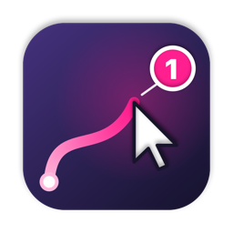
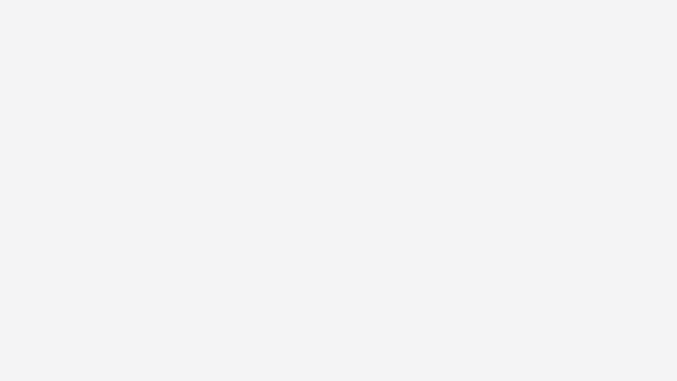
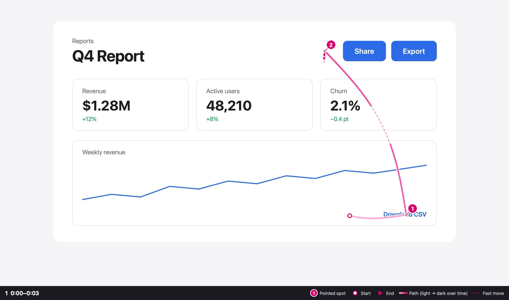

<p align="center">
  
</p>

<h1 align="center">Yubisashi</h1>

<p align="center">
  Point at your screen, say what you want, and paste it into your coding agent.<br>
  <sub><i>Yubisashi</i> (指差し) means “pointing” in Japanese.</sub>
</p>

<p align="center">
  
</p>

## Why

“Move this up here” is easy to say and hard to type. A screenshot can’t tell your agent *which* element you mean or *where* it should go.

Yubisashi records your voice and your cursor together, and links every “this” and “here” to the spot you pointed at.

## How it works

1. Press **⌃⌥R** and talk while you point.
2. Press **⌃⌥R** again. A `review.md` with annotated screenshots is copied to your clipboard.
3. Paste it into Claude Code, Codex, Cursor, or any coding agent that can read local files.

What the agent receives:

<p align="center">
  
</p>

> Move this①. Up here②.

Each number in the transcript points to the same number in the image. The pink line is the cursor path, light to dark over time.

## Results

Same screen, same words, two ways of handing them to Claude Code:

| | “this” / “here” resolved | Asked which element | Tokens | Time |
|---|---|---|---|---|
| Screenshot + text | 67% (18/27) | 17 times | 61k | 82 s |
| **Yubisashi** | **100% (27/27)** | **0 times** | 64k | 60 s |

A small benchmark: 2 synthetic UI tasks, 6 runs each. The prompts, scoring and every raw answer are in [benchmark/](benchmark/).

## Install

Requires **macOS 26** and Xcode (Swift 6).

```bash
git clone https://github.com/sadakoa/yubisashi
cd yubisashi
./scripts/build.sh --install
```

On first use, allow **Microphone** and **Screen & System Audio Recording**, then restart the app.
**Accessibility** is optional: it adds the pointed element’s name, DOM id/classes and page URL to the review.

## Menu bar

- **Start Recording** (⌃⌥R). While recording, the pill at the bottom also has Stop and Discard.
- **Copy Latest Review** copies the last review again.
- **Settings**: UI language (English / 日本語), speech (Auto / English / 日本語), element info, open at login.

## Privacy

- **Nothing leaves your Mac.** Recording and transcription run on-device; there is no network code.
- **Only the latest recording is kept**, in `~/Library/Caches/Yubisashi/`, readable only by you.
- **No keystrokes are recorded.** Text in input and password fields is never read.
- **What you paste is what the agent sees**: the images, the transcript and the folder path.

## Development

See [docs/DEVELOPMENT.md](docs/DEVELOPMENT.md).

## License

MIT
